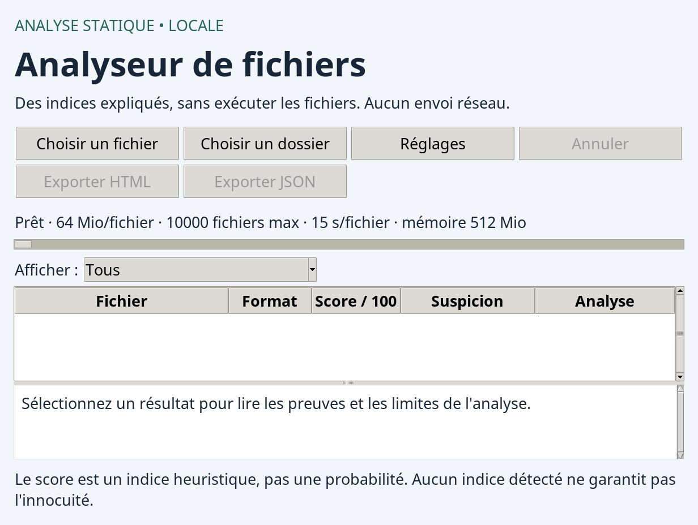

# Analyseur de fichiers suspects

**Version 0.2.1 · Python 3.11+ · Analyse statique locale**

Un outil qui examine les fichiers **sans les exécuter** et explique les indices détectés : nom trompeur, signature binaire incohérente, motifs YARA, imports ou sections PE inhabituels. Il propose une interface de bureau et une ligne de commande, avec export JSON/HTML.

Les analyses restent sur la machine : aucun téléversement ni service de réputation externe n'est utilisé. Le score est heuristique, **pas une probabilité de malware**. L'absence d'indice ne garantit pas l'innocuité d'un fichier.



## Installation — une seule fois

Après avoir cloné ou téléchargé le dépôt, ouvrir un terminal à sa racine.

### Linux

Python 3.11 ou plus récent est nécessaire. Sous Debian/Ubuntu, si les composants Python ou graphiques sont absents :

```bash
sudo apt install python3-venv python3-tk
```

Installer ensuite le projet dans son environnement dédié :

```bash
python3 -m venv .venv
.venv/bin/python -m pip install -e .
bash scripts/install-launchers.sh
```

Le script crée `anlz`, `analyseur`, `file-detector-gui` et `file-detector` dans `~/.local/bin`. Il refuse de remplacer une commande existante différente et peut être relancé sans créer de doublons. Aucun `sudo` n'est nécessaire pour installer le projet ou ces raccourcis.

Si `~/.local/bin` n'est pas déjà dans le `PATH`, ajouter cette ligne à `~/.zshrc` avec zsh, ou à `~/.bashrc` avec bash, puis ouvrir un nouveau terminal :

```bash
export PATH="$HOME/.local/bin:$PATH"
```

### Windows

```powershell
py -m venv .venv
.venv\Scripts\python.exe -m pip install -e .
.venv\Scripts\file-detector-gui.exe
```

Les raccourcis du script Bash concernent Linux. Cette version est validée sous Linux ; Windows/macOS ne sont pas encore validés. `yara-python` peut nécessiter un compilateur C si aucune roue binaire n'existe pour la version de Python utilisée.

## Lancer l'application au quotidien

Une fois les raccourcis installés, depuis **n'importe quel dossier** :

```bash
analyseur
```

`file-detector-gui` lance la même interface. **Il n'est pas nécessaire de recréer `.venv`, de l'activer ou de réinstaller les dépendances à chaque lancement.**

Sans raccourci, depuis la racine du projet :

```bash
.venv/bin/file-detector-gui
```

L'installation avec `-e` prend en compte les modifications du code au prochain lancement. Si les dépendances changent, relancer `.venv/bin/python -m pip install -e .`. Si le projet est déplacé, recréer son environnement virtuel au nouvel emplacement et actualiser les raccourcis ; le script signale les anciens liens au lieu de les écraser.

## Utiliser l'interface

1. **Choisir un fichier** ou **Choisir un dossier**.
2. Suivre la progression et filtrer les résultats.
3. Sélectionner une ligne pour lire le détail du score, les preuves et les contrôles réalisés.
4. Exporter en **HTML** pour lire ou partager le rapport, ou en **JSON** pour le traiter avec un programme.

La fenêtre s'ouvre agrandie selon l'écran et demande la maximisation au gestionnaire de fenêtres. Les boutons passent sur plusieurs lignes si nécessaire ; le tableau et les détails restent visibles avec de grandes polices.

Le bouton **Annuler** interrompt le processus du fichier actif et arrête le lot. Les résultats déjà obtenus restent exportables. Fermer la fenêtre demande aussi le nettoyage du processus actif.

### Réglages disponibles

| Réglage | Valeur par défaut |
|---|---:|
| Taille maximale par fichier | 64 Mio |
| Nombre maximal de fichiers | 10 000 |
| Délai global par fichier | 15 secondes |
| Budget mémoire par processus | 512 Mio |
| Délai de correspondance YARA | 5 secondes |
| Parcours des sous-dossiers | Activé |
| Exclusions | `.git`, `.venv`, `__pycache__` |

Dans **Réglages**, ces valeurs sont modifiables ainsi que le dossier de règles YARA. Les exclusions sont des motifs de nom ou de chemin relatif, avec respect de la casse et séparateurs `/`. Exemple : `.git; .venv; __pycache__; *.tmp; build`. Un dossier exclu compte pour une entrée et sa descendance n'est pas parcourue.

Les préférences graphiques sont conservées hors du projet dans `$XDG_CONFIG_HOME/analyseur-fichier/settings.json`, ou `~/.config/analyseur-fichier/settings.json` par défaut. Elles n'affectent pas les valeurs par défaut de la CLI. Les réglages sont verrouillés pendant une analyse.

## Essayer avec les fichiers fournis

Les exemples sont synthétiques et inoffensifs. Pour commencer, choisir `samples/bonjour.txt` dans l'interface : son score attendu est 0.

Le dossier `samples/tests_suspects_inoffensifs/` contient **12 cas de test** : témoins, motifs YARA, extensions trompeuses, PE synthétiques, fichier tronqué et format inconnu. Les scores attendus vont de 0 à 100. Les états incomplets sont intentionnels pour certains cas.

Voir le [guide des fichiers de test](docs/JEU_DE_TESTS.md). Ces exemples vérifient le comportement du logiciel ; ils ne constituent pas une mesure de détection sur corpus réel.

## Ligne de commande

Depuis la racine du projet, après installation des raccourcis :

```bash
# Analyser un témoin et produire deux rapports
file-detector samples/bonjour.txt --json reports/demo.json --html reports/demo.html

# Analyser un fichier et détailler le score
file-detector /chemin/vers/fichier.exe --explain

# Analyser un dossier avec des limites et exclusions personnalisées
file-detector /chemin/vers/dossier --timeout 10 --memory-mb 256 \
  --max-size-mb 32 --max-files 500 --exclude '*.tmp' --exclude build

# Limiter le parcours au dossier sélectionné
file-detector /chemin/vers/dossier --no-recursive

# Consulter toutes les options
file-detector --help
```

Sans raccourci, remplacer `file-detector` par `.venv/bin/file-detector` depuis la racine du projet. Après activation de l'environnement, `python -m file_detector ...` fonctionne aussi.

`--exclude` est répétable et ajoute des motifs aux exclusions par défaut. `--rules DOSSIER` remplace les règles intégrées par celles du dossier choisi. `--yara-timeout` règle le délai de correspondance YARA. `--quiet` masque la progression et `--explain` détaille les contributions au score.

Les rapports existants sont préservés : choisir une autre destination ou ajouter `--force` pour demander leur remplacement. Un export ne peut pas remplacer directement un fichier inclus dans son rapport. Le HTML est autonome, sans JavaScript ni ressources externes. Le schéma JSON actuel est **1.1**.

| Code de sortie | Signification |
|---|---|
| `0` | Analyses complètes, aucun score ≥ 25 ; des indices faibles peuvent exister |
| `1` | Au moins un score ≥ 25, sans analyse incomplète |
| `2` | Erreur, résultat incomplet, fichier ignoré/non pris en charge ou limite atteinte ; prioritaire sur `1` |
| `130` | Interruption clavier |

## Ce qui est analysé

- Nom, taille, extension finale et extensions potentiellement trompeuses.
- Signatures MZ, PDF, ZIP, JPEG, PNG, GIF, ELF et OLE ; comparaison avec l'extension, y compris les documents OOXML basés sur ZIP.
- Empreinte SHA-256 des mêmes octets que ceux soumis aux analyseurs.
- Correspondances YARA avec explication et offsets des motifs.
- PE Windows : architecture, imports normaux/différés, sections, entropie, permissions et avertissements du parseur.
- Combinaisons d'imports, sections inscriptibles/exécutables, forte entropie, noms évoquant UPX et nombre inhabituel de sections.

`MZ` seul ne confirme pas un PE valide. Un import isolé ne suffit pas à déclencher les règles de combinaison. Les PDF, images, archives et textes reçoivent uniquement les contrôles génériques et YARA : leur contenu interne n'est pas interprété. ELF, OLE et les formats inconnus sont signalés sans analyse spécialisée.

### Comprendre le score et l'état

Le score déduplique les indices par code, plafonne chaque famille puis applique un plafond global de 100. Plafonds : **identité 30**, **imports 35**, **structure 35**, **YARA 30**, **marqueurs de test 0**. Par exemple, 40 points bruts d'identité donnent 30 points retenus.

| Score | Niveau affiché |
|---|---|
| 0, contrôles terminés | Aucun indice détecté |
| 0, analyse non complète | Indéterminé |
| 1–24 | Faible |
| 25–59 | Modéré |
| 60–100 | Élevé |

L'état d'analyse est indépendant du score : `complete`, `partial`, `unsupported`, `skipped`, `error`, `timeout`, `resource_limit` ou `cancelled`. Un score élevé peut accompagner une analyse incomplète. `complete` signifie que les contrôles prévus ont terminé, pas que le fichier est sain ou analysé exhaustivement.

Le champ JSON `score_breakdown` conserve les points bruts, plafonds, contributions, sous-total, réduction globale et total. Ces informations sont aussi lisibles dans l'interface et le HTML.

### Règles YARA

Les règles intégrées sont dans `src/file_detector/rules/`. Un dossier personnalisé **les remplace**. Les sources `.yar` et `.yara` sont figées au début du lot, limitées à 128 fichiers et 8 Mio, puis compilées dans chaque processus enfant. Les directives `include` sont désactivées.

Métadonnées reconnues : `description`, `severity` (`low`, `medium`, `high`). Le tag `test` impose zéro point. Le SHA-256 du jeu de règles figure dans le rapport pour faciliter la reproductibilité. Les règles fournies sont pédagogiques et ne forment pas une base exhaustive de menaces.

## Isolation et limites

Un nouveau processus analyse chaque fichier. Le superviseur surveille sa durée et sa mémoire toutes les 50 ms ; le délai global couvre démarrage, lecture, compilation YARA et parseurs. En cas d'arrêt, le dernier snapshot terminé peut conserver des indices et les contrôles restants sont signalés comme incomplets.

Sous Linux, un plafond dur d'espace virtuel complète la surveillance RSS. Sur les autres systèmes, la surveillance RSS est périodique, sans plafond dur dans cette version. Le budget concerne chaque enfant ; les résultats du lot restent en mémoire dans le parent. Les snapshots JSON sont limités à 4 Mio.

Cette isolation de panne et de ressources **n'est pas une sandbox système** : l'enfant garde les droits du compte utilisateur. La lecture des règles personnalisées précède la supervision ; utiliser des règles de confiance. La réaction à l'annulation dépend aussi de l'ordonnancement du système.

Les liens symboliques et fichiers spéciaux ne sont pas lus. Les changements de métadonnées observables pendant la lecture sont signalés. Aucun fichier analysé n'est exécuté, supprimé ou mis en quarantaine. Pas de décompression, désassemblage, analyse dynamique ou réputation externe. Les seuils ne sont pas calibrés sur un corpus représentatif et aucun taux de détection réel n'est revendiqué.

## Développement et vérifications

Installer les outils de développement dans l'environnement existant :

```bash
.venv/bin/python -m pip install -e '.[dev]'
.venv/bin/ruff check src tests
.venv/bin/ruff format --check src tests
.venv/bin/python -m pytest -q
```

Sous Linux sans écran, installer Xvfb et xauth puis inclure les tests graphiques :

```bash
sudo apt install xvfb xauth
xvfb-run -a .venv/bin/python -m pytest -q
```

La suite locale comprend **50 tests**, validés sous Linux avec écran virtuel. Elle couvre moteur, fichiers malformés, erreurs, délais, mémoire, annulation, score, exports et interface. Sans `DISPLAY`, les tests graphiques sont ignorés. Aucun malware réel n'est inclus, téléchargé ou exécuté.

Le workflow [GitHub Actions](.github/workflows/checks.yml) prévoit ces vérifications et la construction du paquet sous Python 3.11 et 3.14. Le résultat distant sera disponible après publication ; les validations locales ne prouvent pas encore la réussite sur les runners GitHub.

## Organisation du projet

```text
.github/workflows/       # Vérifications GitHub Actions
src/file_detector/       # Application, analyseurs, supervision, règles YARA
scripts/                 # Installation des commandes utilisateur
tests/                   # Tests automatisés et générateur de PE en mémoire
samples/                 # Texte et structures synthétiques inoffensifs
docs/                    # Architecture et fichiers de test
reports/                 # Exports locaux, ignorés par Git
dist/                    # Paquets construits localement, ignorés par Git
```

Le coffre Obsidian personnel reste **hors du dossier du projet**. Les notes personnelles, environnements et rapports locaux ne font pas partie du dépôt.

- [Notes de version](PATCH_NOTES.md)
- [Architecture](docs/ARCHITECTURE.md)
- [Fichiers de test](docs/JEU_DE_TESTS.md)
- [Document de conception initial](docs/PROJECT_BRIEF.md)

Références techniques : [pefile](https://pefile.readthedocs.io/en/latest/modules/pefile.html), [yara-python](https://yara.readthedocs.io/en/stable/yarapython.html).
